# GDPR, Green Data, and EU AI Act

This repository contains four notebooks for applying data protection,
sustainable data practices, and EU AI Act requirements to realistic product and
AI-project decisions. The material combines concise legal and operational
context with small Python examples, mini-cases, and exercises that can be run in
VS Code.

## Project at a Glance

The notebooks build a joined-up governance view of personal data, environmental
impact, AI regulation, and the additional risks introduced by agents.

```mermaid
%%{init: {"theme":"base","themeVariables":{"fontFamily":"Arial","primaryTextColor":"#172033","lineColor":"#64748B"},"flowchart":{"curve":"basis","nodeSpacing":36,"rankSpacing":52}}}%%
flowchart LR
    Goal[Assess whether an AI use<br/>is responsible and governable]
    subgraph Understand["<b>1. Understand the Data Responsibility</b>"]
        direction TB
        Context[Processing purpose,<br/>actors and personal data]
        Basis[Lawful basis,<br/>rights and principles]
        Lifecycle[Retention, security<br/>and data lifecycle]
        Responsibility[Data responsibility<br/>position]
        Context --> Basis
        Context --> Lifecycle
        Basis --> Responsibility
        Lifecycle --> Responsibility
    end
    subgraph Assess["<b>2. Assess the AI System</b>"]
        direction TB
        Green[Data, compute and<br/>environmental impact]
        Act[EU AI Act role<br/>and risk classification]
        Agents[Agent autonomy,<br/>tools and transfer risks]
        Profile[Combined AI<br/>risk profile]
        Green --> Profile
        Act --> Profile
        Agents --> Profile
    end
    subgraph Govern["<b>3. Define Proportionate Governance</b>"]
        direction TB
        Controls[Technical and<br/>organizational controls]
        Oversight[Human oversight<br/>and escalation]
        Output[Documented risk position<br/>and governance actions]
        Controls --> Output
        Oversight --> Output
    end
    Goal --> Understand --> Assess --> Govern
    classDef goal fill:#172033,color:#FFFFFF,stroke:#172033,stroke-width:2px;
    classDef input fill:#FFFFFF,color:#172033,stroke:#4677A8,stroke-width:1.5px;
    classDef work fill:#FFFFFF,color:#172033,stroke:#3B8A5A,stroke-width:1.5px;
    classDef output fill:#FFFFFF,color:#172033,stroke:#B77A1F,stroke-width:1.5px;
    class Goal goal;
    class Context,Basis,Lifecycle,Responsibility input;
    class Green,Act,Agents,Profile work;
    class Controls,Oversight,Output output;
    style Understand fill:#F5F9FD,stroke:#9BB8D2,stroke-width:1.5px;
    style Assess fill:#F4FAF6,stroke:#9DC8AD,stroke-width:1.5px;
    style Govern fill:#FFFAEF,stroke:#D7B66B,stroke-width:1.5px;
```



## Learning Objectives

By the end of this repository, you should be able to:

- Explain the GDPR principles, lawful bases, and data-subject rights that shape
  product decisions.
- Identify data-minimization, retention, confidentiality, and accountability
  controls in a simple data workflow.
- Assess data and compute choices through a sustainability lens.
- Distinguish the EU AI Act risk categories and the responsibilities of
  providers and deployers.
- Connect GDPR and EU AI Act obligations to documentation, logging, and product
  delivery questions.
- Assess how an AI agent's context, memory, tools, and actions change privacy,
  sustainability, security, and human-oversight requirements.

## Learning Path

The modules build on each other in order.

### Compliance and Sustainable Data Foundations

| File | Description |
|---|---|
| [**01 - GDPR Principles**](01_GDPR_Principles.ipynb) | Explore GDPR actors, lawful bases, Article 5 principles, data-subject rights, pseudonymization, and retention controls. |
| [**02 - Green Data Practices**](02_GreenData_Practices.ipynb) | Examine carbon-aware computing, efficient data choices, caching, lifecycle policies, and sustainable ML trade-offs. |

### AI Governance

| File | Description |
|---|---|
| [**03 - EU AI Act**](03_EU_AI_Act.ipynb) | Review the AI Act timeline, risk categories, role-based obligations, technical documentation, logging, and its overlap with GDPR. |
| [**04 - AI Agents: Risks and Governance**](04_AI_Agents_Risks_and_Governance.ipynb) | Examine agent data flows, international-transfer questions, sustainability, prompt injection, tool permissions, and human oversight without operating an agent. |

### Additional Folders and Files

| File / Folder | Description |
|---|---|
| [**.python-version**](.python-version) | Selects Python 3.13 for local development. |
| [**pyproject.toml**](pyproject.toml) | Declares the project and its notebook-kernel dependency. |
| [**uv.lock**](uv.lock) | Pins the resolved dependency versions used by `uv`. |
| [**assets**](assets/) | Local illustrations used in the AI-agent governance notebook. |

## Prerequisites

- **Audience:** PMs and cross-functional teammates working on AI initiatives; no
  prior legal background is assumed.
- **Technical prerequisites:** basic Python familiarity (reading and editing
  simple functions and dictionaries) and comfort opening a repository in VS
  Code. No data science or ML engineering experience is required.

## Setup

> [!NOTE]
> Throughout these steps, text in angle brackets like `<repo-name>` is a
> **placeholder**. Replace it, including the `< >` brackets, with your own
> value. For example, `cd <repo-name>` becomes
> `cd aipm-gdpr-greendata-aiact`.

### 1. Create the Repository from the Template

Click **Use this template** on GitHub.

When creating the repository:

- Set yourself as the **Owner**.
- Choose a repository name.
- Disable **Include all branches**.
- Click **Create repository**.

> [!IMPORTANT]
> If you are working in pairs or groups, only one person should complete this
> step.

### 2. Add Collaborators (Pairs/Groups Only)

If working with teammates:

1. Open the repository on GitHub.
2. Go to **Settings -> Collaborators**.
3. Add your teammates as collaborators.
4. Share the repository link with your team.

Teammates should accept the invitation before continuing.

### 3. Clone the Repository

Copy the SSH URL from the **Code** button on GitHub, then run:

```bash
git clone <copied-ssh-url>
```

The copied SSH URL will look like
`git@github.com:<your-username>/<repo-name>.git`.

### 4. Move into the Project Folder and Install Dependencies

This installs dependencies and creates a virtual environment in `.venv/`.

```bash
cd <repo-name>
uv sync
```

### 5. Open the Notebooks

Open VS Code from the project root so it detects the environment created by
`uv sync`:

```bash
code .
```

Open a notebook and select the Python environment created by `uv sync` as the
kernel.

## References & Further Reading

- [General Data Protection Regulation](https://eur-lex.europa.eu/eli/reg/2016/679/oj):
  The official GDPR text on EUR-Lex.
- [EU AI Act](https://eur-lex.europa.eu/eli/reg/2024/1689/oj): The official AI
  Act text on EUR-Lex.
- [European Commission: Regulatory framework for AI](https://digital-strategy.ec.europa.eu/en/policies/regulatory-framework-ai):
  Practical context on the EU's AI regulatory framework.
- [Green Software Foundation](https://greensoftware.foundation/): Resources on
  sustainable software and carbon-aware computing.
- [European Data Protection Board: International data transfers](https://www.edpb.europa.eu/topics/international-transfers-and-international-cooperation_en):
  Official guidance on transfers of personal data outside the EU.
- [NIST AI Risk Management Framework](https://www.nist.gov/itl/ai-risk-management-framework):
  Risk-management framework and resources for AI systems, including generative
  AI.
- [OWASP AI Agent Security Cheat Sheet](https://cheatsheetseries.owasp.org/cheatsheets/AI_Agent_Security_Cheat_Sheet.html):
  Practical guidance on agent permissions, prompt injection, and high-risk
  actions.
